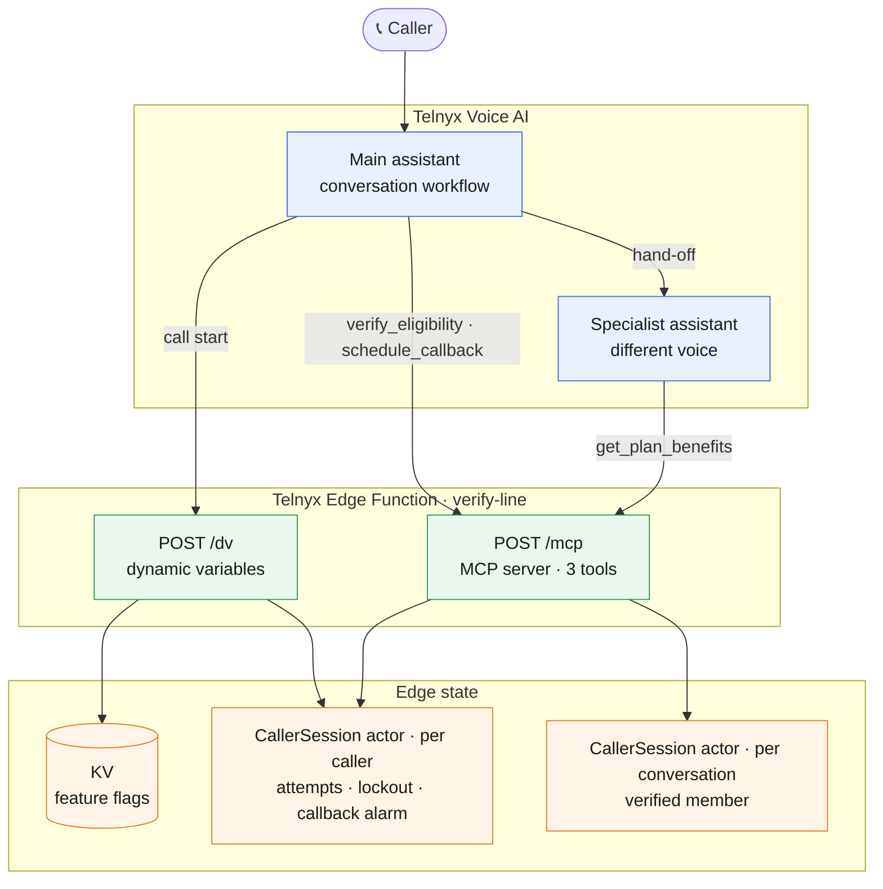
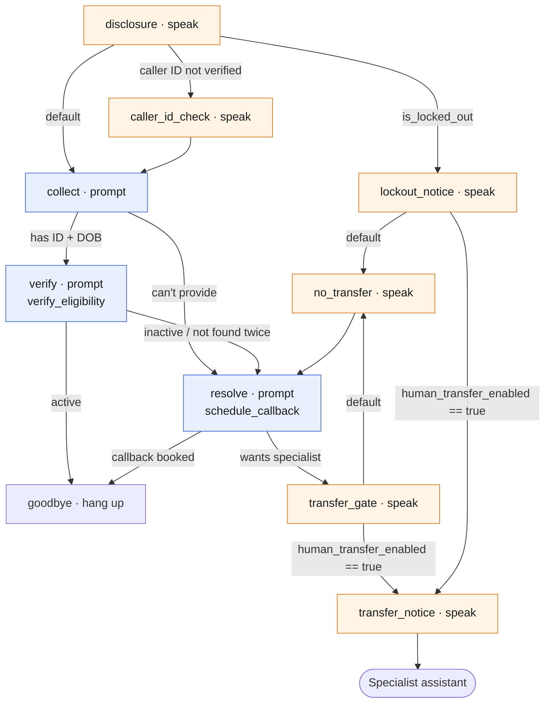

# Riverside Verify Line

A voice assistant that checks a pediatric patient's insurance eligibility over the phone, built on Telnyx Voice AI, an MCP server and a StatefulActor on a Telnyx Edge Function, and KV feature flags.

| | |
|---|---|
| **Phone** | +1 786 892 9548 |
| **Edge Function** | https://verify-line-9f348eb3-0.telnyxcompute.com |
| **How to test** | [`DEMO.md`](DEMO.md): what to say on each path |
| **Main assistant** | `assistant-57e256d2-93ac-49e0-ae12-9e8ff11c1da7` ([`workflow.json`](workflow.json)) |
| **Specialist** | `assistant-6a391369-bd94-4446-a17a-8ad896efe50e` ([`specialist.json`](specialist.json)) |

## Architecture



### Why each primitive

- **KV:** ops switches (`human_transfer_enabled`, `after_hours_mode`). Read once per call, changed with no deploy.
- **StatefulActor per caller** (keyed by a hash of the phone number): the attempt counter and 30-minute lockout. Single-threaded per caller, so concurrent calls can't lose a count.
- **StatefulActor per conversation** (keyed by Telnyx's `conversation_id`): passes the verified member to the specialist in code, not in the prompt.
- **Actor alarm:** fires the callback 2 minutes after booking. Survives restarts.
- **Speak nodes:** the recording disclosure and transfer notice, word for word.
- **Expression edges:** policy (locked out? transfers allowed?), evaluated by Telnyx, so the model can't override it.
- **LLM edges:** intent only (does the caller want a specialist or a callback?).

## Workflow



Orange nodes are speak nodes and blue nodes are prompt nodes. Edges with a variable condition are expression edges; the rest are LLM or default edges.

## Data handling

- Actor keys are a SHA-256 of the phone digits, because instance names show up in platform logs.
- Logs carry `***` plus the last 4 digits of the phone. Member IDs and dates of birth are never logged.
- The admin reset token lives in KV and the local `.env`, never in code.

## Observability

Details: [`docs/observability.md`](docs/observability.md).

- **Structured logs:** one JSON line per request with `route`, `action`, `outcome`, masked caller, `conversationId`, and timing split into `kvMs`, `actorMs` and `totalMs`. Slow requests (over 500 ms) log as `warn`, failures as `error`.
- **Signals beyond logs:** platform metrics (p50/p95/p99), actor invocation records (including every alarm), and state read-backs (`alarmInMs`, `pendingCallback`).
- **One trace key:** `conversationId` joins the transcript, the webhook and every tool call.

**How I'd know within a minute that it's broken:**
1. Filter the last 5 minutes of logs for `error` or `warn`. `/dv` errors mean calls start on defaults, `/mcp` errors mean tools are failing, and `kvError` means flags fell back to defaults.
2. Check `telnyx-edge metrics verify-line` against the baseline (100% 2xx, p95 134 ms) to see whether it's everyone or one caller.
3. Open the transcript for that `conversationId` to see which node misrouted.
4. Next step, not built yet: export logs and alert on `level=error` or `/dv` p99 over 1.5 s.

## Debugging story

Full write-up: [`docs/debugging-narrative.md`](docs/debugging-narrative.md).

- **Bug:** with transfers switched off in KV, a caller asking for a specialist was transferred anyway.
- **Clue:** the transcript showed the assistant had offered only a callback, so the flag had reached it.
- **Cause:** the transfer was an LLM edge, so the model decided, not the flag.
- **Fix:** an expression-edge gate that Telnyx evaluates before the model turn.

## Setup

```sh
npm install && npx tsc --noEmit
telnyx-edge ship
telnyx-edge storage kv key put <ns> flags/human_transfer_enabled true
telnyx-edge storage kv key put <ns> admin/reset_token <secret>
curl -X POST https://api.telnyx.com/v2/ai/assistants/<id> \
  -H "Authorization: Bearer $TELNYX_API_KEY" --data-binary @workflow.json
```

To clear a caller's lockout: `POST /admin/reset` with header `x-admin-token` and body `{"phone": "+1…"}`.

## Built with Telnyx Inference

Every source change was written through OpenCode with `telnyx/moonshotai/Kimi-K2.6` ([`opencode.jsonc`](opencode.jsonc)). I reviewed each diff, typechecked, deployed and tested it on a real call.
